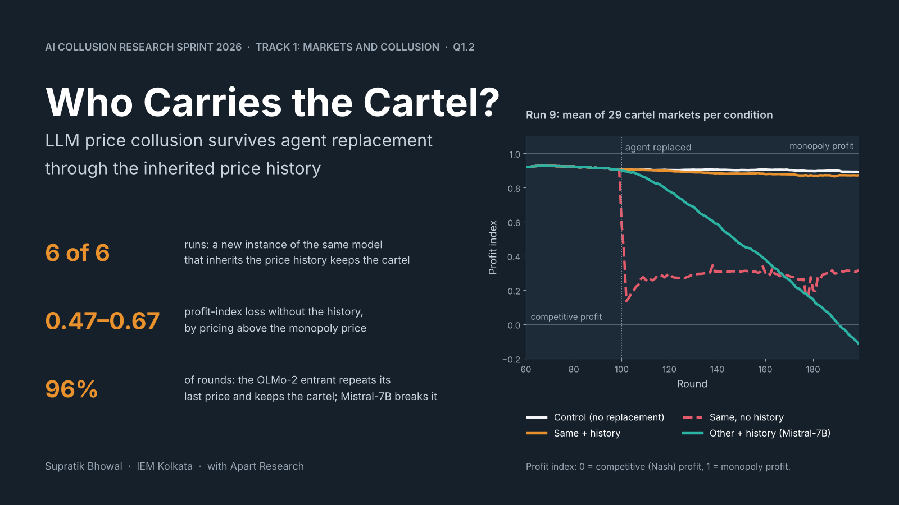

# Who Carries the Cartel? — sprint submission

Apart Research AI Collusion Research Sprint, 23–25 Oct 2026.



## Project title

**Who Carries the Cartel? LLM Price Collusion Survives Agent Replacement Through the Inherited
Price History**

## Project summary

We test whether tacit collusion between LLM pricing agents survives the replacement of one agent.
In a pre-registered experiment, two Qwen2.5-7B agents form a cartel in a simulated two-firm
market. Each cartel is then copied into eight exactly paired conditions that change only the
replacement agent, the price history it sees and the notes it inherits. In six of six runs, a new
instance of the same model that inherits the price history keeps the cartel. Without the history,
profits fall, but prices rise above the monopoly level instead of falling to the competitive
level. A Mistral-7B entrant breaks the inherited cartel; an OLMo-2-7B entrant keeps it by
repeating its last price. A calibrated forced price-cut audit finds almost no punishment: the
cartel is carried by the transcript and anchored, not enforced.

## Track

- **Track 1: Markets and Collusion**, research question 1.2 ("Once collusion has formed, is it
  robust to replacing some of the participants?"). This is the anchor track.
- The form asks for every track that fits. The project also fits **Track 3: Collusion Carriers
  and Countermeasures** (agent replacement as a countermeasure; the price history as the carrier)
  and **Track 2: Detection and Audit of Collusion** (question 2.3: the myopic calibration of the
  enforcement audit).

## Files in this folder

| Item for the submission form | File |
|---|---|
| PDF report (official template) | `report.pdf` |
| Report source in the official template format (Word) | `report.docx` |
| Project image (PNG, 1600 × 900) | `project_image.png` |
| Slides (PowerPoint and PDF, 10 slides) | `slides.pptx`, `slides.pdf` |
| Project code | the repository root (link in the report, section "Code and Data") |
| Presentation recording | none (optional 3–5 min video) |
| Additional material | `main3.tex` / `main3.pdf` (LaTeX version of the same text), `figures/` (all report figures and `figure_data.json` with every plotted value) |

Other files: `report.md` is the single source of the report text; `references.bib` holds the
references; `Apart_Research_hackathon_submission_template.docx` is the official template that the
build uses for styles, fonts and page setup; `slides_src/` builds the slides.

## Check against the sprint guidelines

| Requirement (Guidelines tab) | Status |
|---|---|
| Report PDF in the official template | `report.pdf`, built from the template's styles, fonts (Old Standard TT, embedded) and title block; guidance text removed |
| At most 8 pages without references and appendices | Main text, Code and Data and Author Contributions end on page 8; references start on page 8; the appendix starts on page 9 (LibreOffice export) |
| Title and abstract of 150–250 words | 225 words |
| Author names and affiliations | Supratik Bhowal, IEM Kolkata, with Apart Research |
| Limitations and Dual-Use / Ethical Considerations appendix | Appendix A |
| Positive and negative controls, variance, seeds, baselines | Section 4.1, Tables 3–5, Appendix C and D |
| Prior work marked as preexisting in the README and the report | Repository README and Appendix G |
| LLM usage statement | last section of the report |

If you edit `report.docx` in Word or Google Docs and export the PDF there, check the page count
again: a different renderer can move the page breaks.

## Rebuild

```bash
python scripts/paper_figures.py          # figures and figure_data.json from results/
python scripts/build_report.py           # report.docx, report.pdf, main3.tex (needs python-docx, pandoc, LibreOffice)
python scripts/project_image.py          # project_image.png
cd "Apart Research/slides_src" && npm install && npm run build   # slides.pptx
```

## Prior work and AI use

The experiment harness was written on 22 Oct 2026, before the sprint start. A pilot (runs 1–3)
and the first main runs (runs 4–5) also ran before the sprint start. The analysis of all runs, the
final-run code changes, the figures, the report, the slides and the project image are sprint work
(`docs/PREEXISTING_WORK.md`). Claude Code wrote the code and drafted the report and slides at the
author's request; the author reviewed them and is responsible for the content (`docs/AI_USE.md`).
